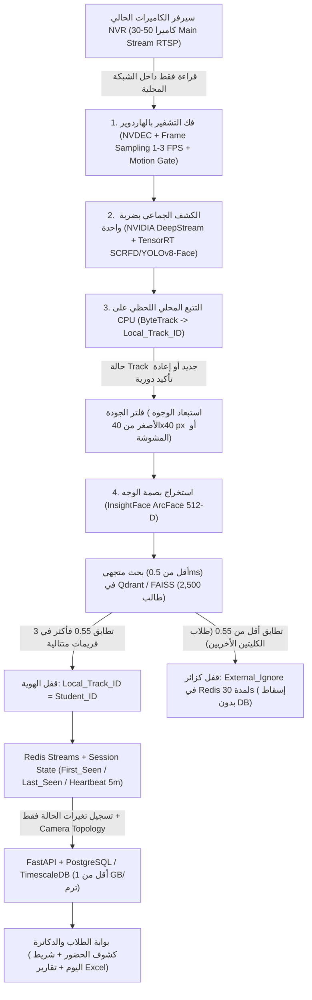

# مقترح مشروع هندسي وتنفيذي (Project Proposal)
## نظام الحضور الذكي وتتبع الحركة بالرؤية الحاسوبية والبوابة الطلابية الموحدة
### Smart Campus CV Attendance & Student Portal

| البند | التفاصيل |
| :--- | :--- |
| **الجهة المقدِّمة** | أسرة **AI Titans** — كلية الحاسبات والذكاء الاصطناعي، جامعة المنوفية |
| **الجمهور المستهدف** | إدارة الكلية والرائد الأكاديمي (د. أسماء، د. مينا، د. أسامة) + الفريق التقني للأسرة |
| **نوع المستند** | مقترح هندسي ومعماري وتنفيذي متكامل (`Technical & Executive Proposal`) |
| **الإصدار والتاريخ** | الإصدار `1.0` — 24 نوفمبر 2026 |

---

## 1. الملخص التنفيذي (`Executive Summary`)

يقدّم هذا المقترح تصميماً هندسياً متكاملاً لمنظومة جامعية ذكية تدمج بين **محرك رؤية حاسوبية لحظي للقراءة فقط (`Read-Only AI Overlay`)** يعمل فوق كاميرات المراقبة وجهاز التسجيل (`NVR`) الموجودين فعلياً داخل الكلية، وبين **بوابة طلابية يومية موحّدة (`Student & Faculty Portal`)** تخدم الطالب وعضو هيئة التدريس في الحضور والغياب، والأعذار، وتكليفات الفرق، والإرشاد الأكاديمي.

بدلاً من بناء بنية تحتية جديدة للكاميرات أو تخزين آلاف الساعات من الفيديو، يعتمد النظام على معالجة البث في الذاكرة المؤقتة (`RAM/VRAM`) واستخراج **بيانات نصية وأحداث زمنية فقط** (`Student_ID`, `Camera_ID`, `Timestamp`) دون حفظ بايت فيديو واحد أو صورة خام للطلاب (`Zero-Video Storage & Privacy-by-Design`).

### نقاط القوة والتميز (`Unique Value Proposition`)
1. **صفر تكلفة كاميرات أو هاردات تخزين:** يركب النظام كطبقة برمجية فوق الـ `NVR` القائم عبر الشبكة الداخلية (`On-Premise`).
2. **مصمم لواقع المبنى المشترك (`Open-Set Rejection`):** يعزل تلقائياً ~**2,500 طالب** من كليتنا وسط ~**5,000 طالب** يرتادون مبنى مشتركاً من 3 كليات على 3 أدوار، دون تتبع أو تخزين أي بيانات لغير المسجلين.
3. **تشغيل لحظي على 30–50 كاميرا بكفاءة عالية:** عبر آلية **`Track Once, Recognize Once`** وفك التشفير بالهاردوير (`NVDEC`) عند `1–3 FPS` مع `Dynamic Batching`، مما يخفض استهلاك الـ `GPU` بأكثر من **90%**.
4. **نظام هجين يضمن عدم ضياع حق أي طالب:** تتكامل الكاميرات مع شريط اليوم (`Daily Timeline`) لتصحيح الغياب وسد الفجوات، مع إبقاء **`Dynamic QR-Code` + `Geofencing`** كبديل طوارئ (`Fallback`) وواجهة لرفع الأعذار والاعتراضات.
5. **أداة استخدام يومي لا موسمية:** دمج شاشة الغياب مع **تاسكات الفرق** و**شات بوت الإرشاد الأكاديمي** يجعل التطبيق منصة حية يفتحها الطالب يومياً.

---

## 2. بيان المشكلة (`Problem Statement`)

تعاني المنظومة الدراسية التقليدية من أربع فجوات مترابطة يسعى هذا المشروع لمعالجتها دفعة واحدة:

1. **قصور طرق تسجيل الغياب الحالية:**
   * أخذ الغياب يدوياً يستهلك 10–15 دقيقة من وقت المحاضرة والسكشن ويعرض الكشوف للأخطاء الورقية.
   * الاعتماد على رموز الـ `QR` الثابتة يتيح التحايل وتمرير الصور بين الطلاب، كما لا يقيس المدة الفعلية لبقاء الطالب داخل القاعة.
2. **تحدي المبنى المشترك والزحمة العالية:**
   * مبنى الكلية يضم 3 أدوار و3 كليات بإجمالي يقارب **5,000 طالب** (بينهم نحو **2,500 طالب** في كليتنا)، ما يجعل أي نظام يتبع الملابس فقط أو يعتمد على بث منخفض الجودة (`Sub-Stream`) عُرضةً للتداخل والأخطاء.
3. **تشتت الطالب في متابعة شؤونه الدراسية:**
   * يعتمد الطلاب على عشرات رسائل الجروبات العشوائية لمعرفة مواعيد التاسكات أو فهم قواعد اللائحة الداخلية والمواد المتاحة للتسجيل وفق الـ `GPA`.
4. **ارتفاع تكلفة الأنظمة التجارية ومخاوف الخصوصية:**
   * الحلول التجارية (`Turnkey Smart Classroom`) مكلفة وتفرض تغييراً في الأجهزة، كما ترفض إدارات الجامعات والطلاب أي نظام يحتفظ بصور الوجوه الخام أو يرسل فيديوهات خارج أسوار الجامعة.

---

## 3. الرؤية الهجينة ومكونات البوابة الطلابية (`Hybrid Concept & Portal Modules`)

تعمل المنظومة كـ **3 طبقات مستقلة متكاملة** (`Decoupled Architecture`):
* **العين (`AI CV Engine`):** قراءة البث من الـ `NVR` لحظياً وإصدار أحداث التواجد والحركة النصية فقط.
* **المخ (`Backend & Databases`):** مقارنة الأحداث بجدول المحاضرات وحساب مدة الجلوس وتخزين بيانات التطبيق.
* **الواجهة (`Student & Faculty Portal`):** تطبيق الموبايل والويب الذي يستخدمه الطالب والدكتور يومياً.

### الشاشات الأربع الرئيسية في البوابة الطلابية

| الوحدة / الشاشة | الوظيفة الأساسية | التكامل الذكي مع المنظومة |
| :--- | :--- | :--- |
| **1. الملف الشخصي والتسجيل الطوعي (`Profile & Opt-in Onboarding`)** | بيانات الطالب الأكاديمية (الفرقة، الـ `GPA`، المواد المسجلة) وتفعيل الاشتراك الطوعي في التعرف الذكي. | يلتقط الطالب طوعياً (`Opt-in`) 3 زوايا سريعة لوجهه؛ تُحوَّل فوراً في الذاكرة إلى بصمة رياضية (`512-D Vector`) ثم **تُحذَف الصور الخام لحظياً**، مما يُغني الكلية عن الاعتماد على صورة واحدة قديمة من منصة ابن الهيثم. |
| **2. الغياب الذكي والأعذار (`Smart Attendance / غياب`)** | عرض سجل المحاضرات والسكاشن مقسّماً بالأسابيع (`Week 1..N`) بحالات واضحة: **حاضر / غياب / بعذر**. | تتغذى الشاشة تلقائياً من محرك الكاميرات (مع عمود `Source = Camera` و`Duration`). وفي القاعات غير المغطاة أو عند الأعطال، يعمل زر **`Dynamic QR-Code` (يتجدد كل 10 ثوانٍ) + `Geofencing`** كبديل فوري (`Fallback`). كما يرفع الطالب الأعذار الطبية والإدارية أو طلب مراجعة عبر `Audit Trail`. |
| **3. تكليفات الفرق (`Cohort Tasks / تاسكات`)** | لوحة مهام منظمة مصنّفة حسب الفرق الدراسية (الفرقة الأولى حتى الرابعة) والمواد. | يضمن متابعة الطلاب للتسليمات دون ضياعها في محادثات الدردشة الجانبية. |
| **4. شات بوت الإرشاد الأكاديمي (`Academic Advising Bot`)** | الإجابة الفورية عن المواد المتاحة للتسجيل وأسئلة اللائحة الداخلية للكلية. | **معزول تماماً عن حمل الكاميرات (`Decoupled`)**: حساب المواد المتاحة يتم عبر **محرك قواعد SQL (`Rule Engine`)** يطابق المواد المجتازة والـ `Prerequisites` وسقف الساعات حسب الـ `GPA` في أجزاء من الثانية، بينما تُجاب أسئلة اللائحة عبر **`RAG`** فوق ملف PDF اللائحة المخزّن متجهياً. |

---

## 4. المعمارية التفصيلية لنظام الكاميرات اللحظي (30–50 كاميرا على جميع الأشخاص)

### 4.1 مخطط تدفق البيانات الشامل (`End-to-End Pipeline`)

---

### 4.2 سر الأداء اللحظي لـ 50 كاميرا و500 شخص معاً: آلية `Track Once, Recognize Once`

التشغيل الساذج (قراءة 50 كاميرا × 30 فريم = `1,500 FPS` وتشغيل التعرف على كل وجه في كل فريم) يؤدي لاختناق السيرفرات فوراً. بدلاً من ذلك، صُمم المحرك على مبدأ: **"اكتشف الكل بضربة واحدة، تتبعهم بالرياضيات على الـ CPU، وتعرف على كل شخص مرة واحدة فقط عند دخوله الكادر"**.

فيما يلي ما يحدث حرفياً داخل **ثانية واحدة** عبر 50 كاميرا أمامها 500 طالب:

#### أ) فك التشفير بالهاردوير وأخذ العينات (`Main Stream 1080p + NVDEC + 1–3 FPS + Motion Gate`)
* **لماذا `Main Stream` وليس `Sub-Stream`؟** في مبنى مشترك يضم 5,000 طالب بملابس متشابهة، بث `Sub-Stream` المضغوط (`480p/720p`) يطمس ملامح الوجه على المسافات المتوسطة ويفشل معه تتبع الملابس (`Body Re-ID`). لذلك نسحب الـ **`Main Stream (1080p)`** للحفاظ على وضوح الوجوه في الممرات والمداخل.
* **كيف نمنع اختناق المعالج؟**
  1. نعتمد شريحة **`NVDEC`** المخصصة لفك تشفير الفيديو في كروت `NVIDIA` (منفصلة تماماً عن أنوية الذكاء الاصطناعي `CUDA Cores`).
  2. نلتقط **`1 إلى 3 فريمات في الثانية` (`Frame Sampling`)** فقط لكل كاميرا (أي `100–150 FPS` إجمالاً للـ 50 كاميرا بدلاً من `1,500 FPS`).
  3. **بوابة الحركة (`Motion Gate`):** الكاميرات في القاعات أو الممرات الفارغة لا ترسل أي فريمات لنموذج الكشف، ما يوفر **40%–60%** من الحمل طوال اليوم.
  4. **ملحوظة تحجيم الذاكرة (`VRAM`):** مجرد فتح 50 بث `1080p` متزامناً يستهلك نحو **4–6 GB VRAM** لمخازن الفك (`Decoder Buffers`) قبل تشغيل الموديلات؛ لذا يلزم كارت `16GB VRAM` فأكثر (أو التوزيع على عقدتين إلى ثلاث كما في القسم 6).

#### ب) الكشف الجماعي بضربة واحدة (`One-Stage Detection + Dynamic Batching`)
* نستخدم كاشفاً أحادي المرحلة (`SCRFD` أو `YOLOv8-Face`) محسّناً عبر **`NVIDIA DeepStream + TensorRT FP16`**.
* يمر الكاشف على الصورة مرة واحدة فقط فيُخرج إحداثيات جميع الوجوه والأشخاص في الكادر (سواء كانوا شخصاً واحداً أو 50 شخصاً) في الزمن نفسه تقريباً.
* عبر **`Dynamic Batching` (`batch = 16`)**، تُعالج فريمات 16 كاميرا معاً في ضربة واحدة (`< 15ms`)، ولا يستهلك الكشف للـ 150 فريم/ثانية سوى **25%–35%** فقط من قدرة معالج رسومي قوي.

#### ج) التتبع اللحظي على الـ CPU بدون حمل على كارت الشاشة (`ByteTrack`)
* يأخذ متتبع **`ByteTrack`** مربعات الكشف في كل كاميرا، ويمنح كل شخص رقماً محلياً مؤقتاً (`Local_Track_1`, `Local_Track_2`, ...).
* يعتمد `ByteTrack` على مرشح كالمان (`Kalman Filter`) ومعادلات الارتباط الهندسي التي تعمل على الـ **CPU** في حدود **`0.01ms`**، ما يعني **صفر حمل إضافي على الـ `GPU`**.

#### د) التعرف الذكي وقفل الهوية وعزل غير المسجلين (`ArcFace + Multi-Frame Voting + Open-Set Rejection`)
لو شغّلنا نموذج التعرف على الوجوه لـ 500 شخص × 3 فريمات = 1,500 عملية استدلال/ثانية، سينهار النظام. مع `ByteTrack` يحدث الآتي:

1. **تصفية الجودة (`Quality Filter`):** تُستبعد الوجوه الصغيرة جداً (`< 40×40 px`) أو المشوشة قبل استخراج البصمة.
2. **نموذج متدرّب مسبقاً بدون تدريب من الصفر:** نستخدم **`InsightFace (ArcFace)`** (`One-Shot / Metric Learning`) لتحويل الوجه إلى متجه من **512 رقماً (`512-D Vector`)**، ما يمكّن النظام من العمل بدقة عالية من 1–3 صور مرجعية فقط.
3. **التصويت متعدد الفريمات وقفل الهوية (`Multi-Frame Voting + Identity Lock`):**
   * في أول ثانية لظهور الـ `Track` الجديد (3 فريمات متتالية)، يُقارَن المتجه في `Qdrant` أو `FAISS` مقابل قاعدة بيانات طلاب كليتنا (2,500 طالب) في **أقل من `0.5ms`**.
   * إذا تطابقت الهوية بنسبة تشابه جيب تمام (`Cosine Similarity`) **≥ `0.55`** في 3 فريمات متتالية، يُقفل الـ `Track` في الرامات: **`LOCKED = Student_ID`**.
   * طوال بقاء الطالب أمام نفس الكاميرا (8 ثوانٍ في الممر أو 90 دقيقة في المدرج)، **يتوقف تشغيل `ArcFace` عليه تماماً** مع الاكتفاء بإعادة تأكيد خفيفة كل `30–60` ثانية فقط.
4. **العزل الفوري لطلاب الكليتين الأخريين (`Open-Set Rejection`):**
   * إذا كانت نسبة التطابق **`< 0.55`** (طالب من إحدى الكليتين الأخريين أو زائر)، يُقفل الـ `Track` فوراً بوسم **`External_Ignore`** في `Redis` لمدة **30 ثانية (`TTL`)**؛ فلا يُعاد تشغيل `ArcFace` عليه، ولا يُكتب له أي سجل في قاعدة البيانات، ولا يُتتبَّع عبر المبنى.
5. **المكسب الحسابي الفعلي:** تنخفض عمليات `ArcFace` بنسبة **90%–98%**؛ فبدلاً من 1,500 عملية/ثانية، يُنفَّذ الاستدلال على الوجوه **الداخلة حديثاً للكادر في تلك الثانية فقط** (متوسط **50–120 وجهاً/ثانية** في المبنى كله = **`< 10%` من قدرة الـ `GPU`**)، وبزمن استجابة لحظي يتراوح بين **`0.3` و`1.0` ثانية**.

---

### 4.3 الربط بين الكاميرات وبناء شريط اليوم وتصحيح الغياب

#### 1. التسليم بين الكاميرات المتجاورة (`Face-First + Short-Bridge Re-ID + Camera Topology`)
* **الوجه هو الأساس (`Face-First`):** لأن جميع الكاميرات تسحب `Main Stream`، تتعرف كل نقطة تفتيش (بوابات المبنى، بسطات السلالم، تقاطعات الممرات، وأبواب القاعات) على الوجه مباشرةً وتجدّد هوية الطالب.
* **الجسر القصير (`Short-Bridge Re-ID`):** إذا ظهر شخص مديراً ظهره لكاميرا ممر متصلة بكاميرا سلم غادرها قبل ثوانٍ، تُستخدم بصمة الملابس (`OSNet Re-ID`) كجسر مؤقت لمدة **15 ثانية فقط** للمقارنة مع من غادروا الكاميرا المجاورة في آخر 15 ثانية (وليس مع 5,000 طالب)، وفور التفات الطالب يتأكد النظام بالوجه.
* **خريطة الكاميرات (`Camera Topology & Transition Graph`):** تُعرَّف لكل كاميرا قائمة الجيران وزمن الانتقال المنطقي (`Transition_Time`)؛ فيُمنع رياضياً قبول تطابق مستحيل (مثل ظهور طالب عند البوابة ثم في الدور الثالث بعد 5 ثوانٍ).

#### 2. إدارة الجلسات وتسجيل تغيرات الحالة فقط (`State Transitions & Heartbeats`)
* لتجنب تضخم قاعدة البيانات بملايين الصفوف، يدير **`Redis`** الجلسات اللحظية (`First_Seen`, `Last_Seen`)، ولا يرسل إلى `PostgreSQL / TimescaleDB` عبر `Redis Streams` إلا عند **تغير الحالة فقط**:
  * دخول نطاق كاميرا أو قاعة (`Entry`).
  * الخروج من القاعة أو المبنى (`Exit`).
  * نبضة تأكيد دورية كل **5 دقائق (`Heartbeat`)** أثناء التواجد المستمر في المحاضرة.
* عند بوابات المبنى، يعمل خط عبور افتراضي (`Line Crossing`) لتحديث **عدّاد الحرم الجامعي الحي** (إجمالي الدخول، الخروج، والمتواجدون حالياً).

#### 3. كيف يصحح شريط اليوم (`Daily Timeline`) سجل الغياب تلقائياً؟
1. **سد الفجوات داخل القاعات (`Gap Inference`):** إذا رصدت كاميرا باب المدرج دخول الطالب الساعة `09:02` ولم يظهر في أي كاميرا ممر أو سلم حتى خروجه من الباب نفسه الساعة `10:30`، يستنتج النظام بقاءه داخل المدرج **88 دقيقة** ويحتسب حضوره كاملاً حتى لو حُجب وجهه أثناء الجلوس.
2. **كشف الخروج المبكر:** إذا دخل الطالب أول 10 دقائق ثم خرج وظهرت بصمته في كاميرا ممر أو ساحة، يتوقف عدّاد مدة حضوره عند لحظة مغادرة الباب.
3. **حسم الاعتراضات (`Audit Trail`):** يمنح المعيد أو شؤون الطلاب دليلاً زمنياً قاطعاً لمراجعة أي تظلم غياب، مع فهرس بالثانية واسم الكاميرا للرجوع لتسجيلات الـ `NVR` الأصلية عند الضرورة القصوى.

---

### 4.4 اعتمادية التشغيل المستمر 24/7 (`Reliability & Resilience`)
* **مراقب البث التلقائي (`RTSP Watchdog`):** كل كاميرا تعمل ضمن مسار مراقبة مستقل؛ انقطاع بث كاميرا واحدة أو تجمده لأكثر من 5 ثوانٍ يفعّل `Auto-Reconnect` لها وحدها دون تعطيل باقي الكاميرات.
* **عزل الخدمات (`Docker Compose + restart: always`):** تشغيل كل خدمة (`CV Worker`, `Redis`, `FastAPI`, `PostgreSQL`, `Qdrant`) في حاوية مستقلة تُعاد تشغيلها ذاتياً خلال ثانيتين عند أي خطأ عارض.
* **جدولة الخمول الليلي (`Idle Mode Scheduling`):** العمل بكامل الكاميرات من `7:30 صباحاً` حتى `8:00 مساءً` في أيام الدراسة، والتحول ليلاً وفي الإجازات إلى كاميرات البوابات فقط لإطالة عمر الهاردوير وتقليل استهلاك الطاقة.

---

### 4.5 الشفافية الهندسية وحدود الواقع (`Honest Engineering Boundaries`)
لتأمين المشروع أمام اللجان الأكاديمية وعدم إطلاق وعود غير واقعية، يلتزم الفريق بالحقائق الآتية:
* **لا يوجد نظام كاميرات عالمي يحقق دقة 100% لحظياً في كل الظروف.**
* **الدقة الواقعية المستهدفة:**
  * عند **البوابات ومداخل القاعات** (إضاءة جيدة وزاوية أمامية قريبة): **`95% – 98%`**.
  * في **الممرات المزدحمة وقت خروج المحاضرات** (حجب جزئي، إطراق الرأس، كاب، أو نقاب): **`70% – 85%`** (قد يظهر الشخص مؤقتاً كـ `Unidentified Track` حتى يمر أمام الكاميرا التالية الواضحة).
* **آلية الضمان الصفري للظلم (`Zero-Unfair-Absence Guarantee`):** يتم تعويض أي حالة غير متعرَّف عليها من الكاميرا عبر استنتاج شريط اليوم (`Gap Inference`) أو استخدام زر **`Dynamic QR` + مراجعة الأعذار** داخل التطبيق، فلا يُحسَب الطالب غائباً بسبب عائق بصري.

---

## 5. الخصوصية والأمان والحوكمة (`Privacy-by-Design`)

صُممت المنظومة بحيث تكون **متوافقة كلياً مع متطلبات الخصوصية الجامعية**، خصوصاً ما يتعلق بصور الطلاب والطالبات:

1. **انعدام تخزين الفيديو والصور (`Zero-Video Storage`):** لا يُكتَب أي ملف فيديو أو إطار صورة (`Frame`) على القرص الصلب في سيرفر الذكاء الاصطناعي مطلقاً؛ تتم المعالجة في الـ `RAM/VRAM` وتمحى الإطارات بعد ~15ms.
2. **تحويل لا عكسي للبصمة (`Irreversible 512-D Embeddings`):** لا تُخزَّن صور الطلاب في قاعدة البيانات؛ يُحفظ فقط المتجه الرياضي (`512` رقم عشري مشفّر) الذي لا يمكن رياضياً إعادة بناء صورة الوجه الأصلية منه.
3. **معالجة محلية 100% (`On-Premise`):** جميع بثوث الكاميرات ومقارنات الوجوه تدور داخل شبكة الكلية المعزولة (`VLAN`)، ولا تخرج للإنترنت إلا الأحداث النصية المشفرة لخادم التطبيق.
4. **الاشتراك الطوعي في المرحلة الأولى (`Opt-in Pilot`):** تبدأ التجارب بمتطوعين موافقين صراحةً عبر شاشة الـ `Profile` قبل أي تعميم إداري.
5. **صلاحيات الوصول المبنية على الدور (`RBAC`):** يرى الطالب سجل مواده وشريط يومه الخاص فقط، ويرى الدكتور كشوف طلاب مقرراته فقط، وتقتصر صلاحية مراجعة سجل الحركة الكامل (`Audit Trail`) على الجهات المخوّلة من إدارة الكلية.

---

## 6. المكدس التقني، تحجيم الهاردوير، والتكلفة التقديرية (`Tech Stack, Hardware Sizing & Cost`)

### 6.1 المكدس البرمجي (`100% Open-Source — صفر تكلفة تراخيص`)

| الطبقة | التقنيات المعتمدة | الدور الهندسي |
| :--- | :--- | :--- |
| **سحب البث والمعالجة** | `NVIDIA DeepStream` / `GStreamer` + `NVDEC` + `FFmpeg` + `TensorRT` | فك تشفير بثوث `RTSP Main Stream` بالهاردوير مع `Dynamic Batching` |
| **الذكاء الاصطناعي والتتبع** | `SCRFD` / `YOLOv8-Face` + `InsightFace (ArcFace)` + `ByteTrack` + `OSNet Re-ID` | كشف الوجوه، التتبع المحلي على CPU، واستخراج البصمات |
| **الذاكرة اللحظية والمتجهات** | `Redis` (`Streams` + `Cache`) + `Qdrant` / `FAISS` / `pgvector` | منع التكرار، عزل غير المسجلين، وبحث البصمات في `< 0.5ms` |
| **قاعدة البيانات والباك إند** | `PostgreSQL` + `TimescaleDB` + `FastAPI (Python)` + `Docker Compose` | إدارة الجداول الأكاديمية، شريط اليوم، والـ `REST APIs` |
| **البوابة والشات بوت** | `React / Next.js` أو `Flutter` (`Streamlit` في Phase 1) + `SQL Rules` + `RAG` | واجهة الطالب والدكتور + الإرشاد الأكاديمي من PDF اللائحة |

### 6.2 حجم التخزين المتوقع لـ 3,000 طالب على مدار ترم دراسي كامل

| نوع البيانات | الحجم التقديري لترم كامل | المحرك |
| :--- | :--- | :--- |
| **بصمات وجوه الطلاب (`512-D Vectors`)** | ~`15 MB` | `Qdrant` / `pgvector` |
| **سجلات شريط اليوم وتغيّرات الحالة (`Timeline Events`)** | ~`300 – 500 MB` | `PostgreSQL + TimescaleDB` |
| **سجلات الغياب، الـ QR، الأعذار، والتاسكات** | ~`50 MB` | `PostgreSQL` |
| **الإجمالي الكلي للقاعدة بالكامل** | **أقل من `1 GB`** | أي خادم قياسي |

### 6.3 تحجيم الهاردوير والتكلفة المالية التقديرية (مصر)

| المرحلة / النطاق | المواصفات المطلوبة | التكلفة التقديرية | دورية الدفع |
| :--- | :--- | :--- | :--- |
| **Phase 1: MVP التجريبي** *(فيديو مسجل / 4–8 كاميرات)* | جهاز لابتوب شخصي بكارت `RTX` + باقات مجانية للاستضافة | **`0` جنيه** | مجاني بالكامل |
| **Phase 2: 15–25 كاميرا لحظياً** *(مداخل المدرجات والمعامل)* | جهاز محلي واحد (`On-Premise`): `RTX 4070 Ti Super` أو `RTX 5070 Ti (16GB VRAM)` + `Core i7 / Ryzen 7` + `64GB RAM` + `1TB NVMe` + `UPS 1500VA` | **`90,000 – 115,000` جنيه** *(أو **`0` جنيه** عند استخدام Workstation متاح بمعامل الكلية)* | مرة واحدة فقط |
| **Phase 3: 30–50 كاميرا لحظياً** *(المبنى المشترك بالكامل — 3 أدوار في الذروة)* | **توزيع أفقي (`2–3 Edge Nodes`)**: عقدة لكل دور (`15–17` كاميرا على كارت `RTX 4060 Ti 16GB` أو كارتين `RTX 4070 Ti Super`) ترسل JSON عبر شبكة الكلية إلى سيرفر مركزي واحد (`Redis + PostgreSQL`) | حسب عدد العقد الإضافية *(يضاعف الاعتمادية ويمنع اختناق `VRAM`)* | مرة واحدة عند التوسع |
| **استضافة البوابة السحابية (`Cloud VPS`)** *(ليفتحها الطلاب من خارج الكلية)* | خادم سحابي خفيف (`4 vCPU, 8GB RAM`) يستقبل ملخصات الأحداث النصية فقط | **`800 – 1,300` جنيه** | شهرياً |
| **تشغيل شات بوت الإرشاد (`LLM API`)** | واجهة برمجية خفيفة (`Gemini Flash` / `GPT-4o-mini`) لـ `RAG` | **`250 – 600` جنيه** | شهرياً |

> **مقارنة اقتصادية حاسمة (`On-Premise` مقابل `Cloud`):** رفع بث 50 كاميرا `Main Stream` إلى السحابة يتطلب سرعة `Upload` ثابتة لا تقل عن `250 Mbps` وإيجار سيرفر GPU سحابي بتكلفة **`25,000 – 35,000` جنيه شهرياً**؛ بينما يستهلك الجهاز المحلي شبكة الكلية الداخلية (`1 Gbps` مجانية) ولا يرفع للإنترنت سوى أقل من `1 MB/دقيقة` من البيانات النصية، ما يعني استرداد تكلفته في أقل من **3 أشهر** مقارنة بالسحابة.

---

## 7. خارطة الطريق المرحلية ومؤشرات النجاح (`Phased Roadmap & KPIs`)

يُنفَّذ المشروع عبر **3 مراحل صارمة التدرج** لضمان تحقيق مخرجات ملموسة في كل مرحلة وتفادي الفشل الناتج عن محاولة بناء كل شيء دفعة واحدة:

| المرحلة | النطاق الزمني والعملي | المخرجات القابلة للتسليم (`Deliverables`) | معيار الانتقال للمرحلة التالية |
| :--- | :--- | :--- | :--- |
| **Phase 1: MVP / PoC** *(الهدف الفوري الحالي)* | **3 – 4 أسابيع** فيديو مسجل لمدخل قاعة (`10–15 دقيقة`) بمعالجة `Offline (1–2 FPS)` + **`50–100` متطوع** من أسرة AI Titans | • سكربت `enroll` لـ 3 زوايا وحذف الصور. • `pipeline` متكامل (`Detection + Quality Filter + ByteTrack + ArcFace + 3-Frame Voting`). • باك إند `FastAPI` + لوحة خفيفة (`Streamlit/React`) لعرض الحضور، حساب المدة، عدد الـ `Unknown`، وتصدير `Excel`. | تحقيق `Precision ≥ 95%` و`Recall ≥ 90%` على بيانات الكلية الواقعية + تقديم `Live Demo` لإدارة الكلية ود. أسماء. |
| **Phase 2: نظام الغياب الرسمي والبوابة** | **4 – 6 أسابيع** ربط **`5–10` كاميرات** لمداخل المدرجات والمعامل عبر `RTSP` + إطلاق التطبيق الأساسي | • ربط الأحداث بجدول المحاضرات (`Timetable`) وتسجيل المواد (`Enrollments`). • شاشة الغياب الأسبوعي + `Dynamic QR & Geofencing` + مسار رفع الأعذار. • شاشة تاسكات الفرق + شات بوت الإرشاد (`SQL Rules + RAG`). | تشغيل مستقر لترم تجريبي على دفعة أو مقررين بآلية `RTSP Watchdog` دون فقدان سجلات. |
| **Phase 3: تغطية المبنى وشريط اليوم** | **بعد نجاح Phase 2** التوسع إلى **`30–50` كاميرا** على 3 أدوار عبر `NVDEC + TensorRT + Edge Nodes` | • إعادة بناء شريط اليوم الكامل (`Daily Timeline`) + سد الفجوات (`Gap Inference`) وكشف الخروج المبكر. • ربط `Camera Topology` و`Short-Bridge Re-ID`. • عدّاد الحرم الحي وتحليلات كثافة القاعات (`Crowd Analytics`). | تغطية مستقرة لجميع الأدوار بزمن استجابة لحظي `< 1s` وتقارير دقيقة لإدارة الكلية. |

### مؤشرات القياس التقنية (`Evaluation Metrics`)
في نهاية المرحلة الأولى، يُقاس أداء النظام بالأرقام الفعلية على فيديو حقيقي من الكلية (وليس على داتاسيت جاهزة):
* **الدقة والاسترجاع (`Precision & Recall`)** ومعدل الخطأ الإيجابي/السلبي (**`FAR / FRR`**).
* **زمن الاستجابة الفعلي (`End-to-End Latency`)** من ظهور الطالب حتى تسجيل الحدث (`الهدف: ≤ 1.0 ثانية`).
* **استهلاك الموارد (`GPU Utilization & VRAM Footprint`)** لضمان قابلية التوسع الحسابي قبل طلب الربط بالـ `NVR`.

---

## 8. هيكل الفريق والخبرات المطلوبة (`Team Structure & Skills`)

لا يتطلب المشروع في مرحلته الأولى بناء شبكات عصبية من الصفر؛ بل يتطلب فريقاً متكاملاً من **5 إلى 8 طلاب** موزعين على **4 مسارات واضحة**:

| المسار | العدد المقترح | المهام المسندة | مستوى الخبرة المطلوب |
| :--- | :--- | :--- | :--- |
| **1. الرؤية الحاسوبية والذكاء الاصطناعي (`CV & AI`)** | 2 – 3 طلاب | تشغيل `YOLOv8-Face/SCRFD` و`InsightFace (ArcFace)`، دمج `ByteTrack`، ضبط التصويت والعتبات، وقياس `Precision / Recall / FAR / FRR`. | **متوسط:** إجادة `Python` + أساسيات `OpenCV` + فهم `Cosine Similarity` والبحث المتجهي `FAISS/Qdrant`. |
| **2. الباك إند وقواعد البيانات (`Backend & DB`)** | 1 – 2 طالب | تصميم جداول `PostgreSQL + TimescaleDB + pgvector`، بناء `FastAPI` للغياب والأعذار و`Dynamic QR`، وتطوير شات بوت الإرشاد (`SQL Rules + RAG`). | **مبتدئ إلى متوسط:** `Python (FastAPI)` + `SQL` + أساسيات `Redis` و`REST APIs`. |
| **3. الواجهات وتجربة المستخدم (`Frontend / Dashboard`)** | 1 – 2 طالب | بناء لوحة عرض MVP السريعة (`Streamlit` أو `React`) ثم تطوير واجهات البوابة الأربع (`Profile`، `غياب`، `تاسكات`، `إرشاد`) وتصدير `Excel`. | **مبتدئ إلى متوسط:** `React / Next.js` أو `Flutter` (و`Streamlit` للـ MVP). |
| **4. الأنظمة والفيديو والـ MLOps (`Systems & Video`)** | 1 طالب *(بقيادة معماري النظام)* | قراءة ملفات الفيديو وبثوث `RTSP` عبر `FFmpeg / GStreamer / NVDEC`، تصدير `ONNX / TensorRT`، إعداد `Docker Compose` و`RTSP Watchdog`. | **متوسط:** إلمام بـ `Linux`، `Docker`، وأساسيات `CUDA / ONNX` وتدفقات الفيديو. |

---

## 9. مصفوفة المخاطر وخطط التخفيف (`Risks & Mitigation`)

| الخطر المحتمل | مستوى الأثر | خطة التخفيف الهندسية والإدارية |
| :--- | :---: | :--- |
| **رفض الموافقات أو مخاوف خصوصية صور الطلاب والطالبات** | عالٍ | تطبيق `Privacy-by-Design` الصارم (`Zero-Video` + `512-D Vectors` غير قابلة للاسترجاع + معالجة `On-Premise` محلية) والبدء بـ `50–100` متطوع بنظام `Opt-in` قبل مخاطبة إدارة الكلية لتعميم التجربة عبر د. أسماء ود. مينا ود. أسامة. |
| **ضعف الدقة في الممرات المزدحمة أو مع الكاب والنقاب** | متوسط – عالٍ | الاعتماد على `Main Stream 1080p` عند المداخل، اشتراط `3-Frame Voting` لمنع التطابق الخاطئ، وسد الفجوات بشريط اليوم (`Gap Inference`) مع إتاحة `Dynamic QR` وطلب المراجعة كصمام أمان. |
| **تداخل طلاب الكليتين الأخريين في المبنى المشترك** | متوسط | تفعيل `Open-Set Rejection` (`< 0.55` ⟶ `External_Ignore` لمدة 30 ثانية في `Redis`) + فلتر جغرافية الكاميرات (`Camera Topology`) لتجاهل أي عابر غير مسجل. |
| **اختناق ذاكرة `VRAM` أو كارت الشاشة وقت الذروة** | عالٍ | الالتزام بـ `Frame Sampling (1–3 FPS)` + `Motion Gate` + قفل الهوية عبر `ByteTrack`، والتوسع الأفقي بتوزيع الكاميرات (`15–20` كاميرا لكل `GPU Edge Node`) في المرحلة الثالثة. |
| **انقطاع بث الكاميرات أو الكهرباء عن سيرفر المعالجة** | متوسط | `RTSP Watchdog` يعيد توصيل كل كاميرا منفردة تلقائياً + حاويات `Docker (restart: always)` + وحدة طاقة غير منقطعة `UPS 1500VA` + استمرار عمل البوابة الطلابية والـ `QR Fallback` سحابياً دون توقف. |
| **توسع النطاق قبل النضج (`Scope Creep`)** | عالٍ | الالتزام الصارم بخارطة المراحل: عدم الانتقال لـ 30–50 كاميرا أو التتبع الكامل قبل نجاح `Phase 1 (MVP)` بالأرقام على فيديو واحد و50–100 متطوعاً. |

---

## 10. الخطوات التالية للاعتماد والتنفيذ (`Next Steps`)

للانتقال من مرحلة التصور إلى التنفيذ الفعلي بأقل احتكاك وتكلفة **`0` جنيه**، يُقترح اعتماد الخطوات الأربع التالية فوراً:

1. **الاجتماع التقني الداخلي (`Kickoff`):** عرض هذا المقترح على القيادة التقنية في أسرة **AI Titans** وتثبيت فريق الـ MVP (5–8 أفراد عبر المسارات الأربعة).
2. **تثبيت المرجعية البرمجية (`ARCHITECTURE.md`):** اعتماد قواعد الخصوصية والمعمارية وبدء هيكلة مستودع المشروع للمرحلة الأولى فقط (`Phase 1`).
3. **تنفيذ تجربة الـ MVP خلال 3–4 أسابيع:**
   * تسجيل 3 زوايا طوعية لـ 50–100 متطوع من طلاب الأسرة وتحويلها إلى بصمات في `FAISS/Qdrant`.
   * اختبار خط الرؤية الحاسوبية على فيديو حقيقي واحد لمدخل مدرج/قاعة واستخراج كشف الحضور ومؤشرات الدقة والسرعة.
4. **العرض الميداني على إدارة الكلية (`Live Demo`):** تقديم النموذج الشغال بالأرقام الموثقة إلى **د. أسماء** و**د. مينا** تمهيداً لطلب التنسيق مع **د. أسامة** والحصول على تصريح القراءة من سيرفر كاميرات الكلية (`NVR`) لبدء المرحلة الثانية.
